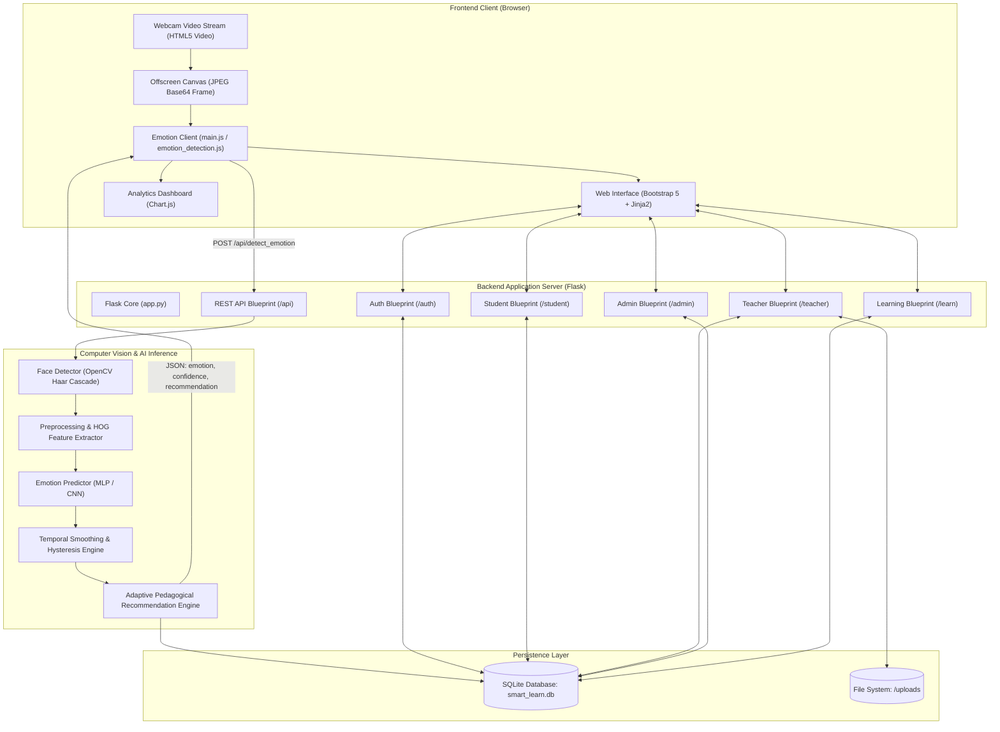
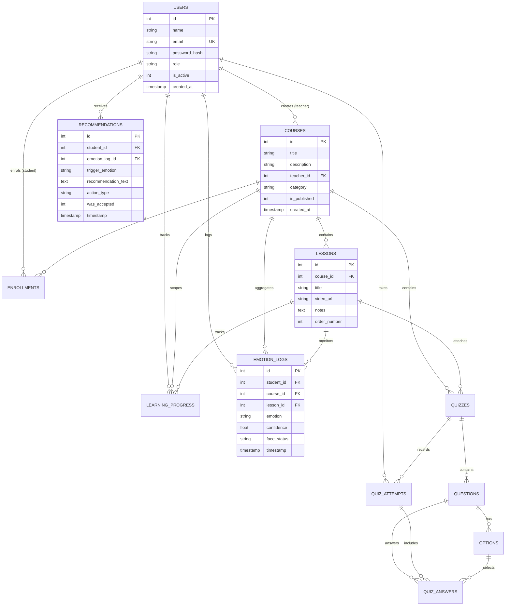

# Smart Online Learning System Using Emotion Detection
## Comprehensive Technical Documentation & Architecture Reference

---

## 1. Executive Summary

The **Smart Online Learning System Using Emotion Detection** (SmartLearn) is an AI-powered Learning Management System (LMS) designed to solve the critical engagement and feedback void in remote education. In traditional virtual classrooms, instructors cannot gauge student confusion, boredom, or frustration. 

SmartLearn bridges this gap by combining:
1. **Real-Time Computer Vision & Emotion Classification**: Captures webcam video frames directly in the browser and predicts emotional states using multi-region facial feature extraction and machine learning.
2. **Adaptive Recommendation Engine**: Evaluates emotional trajectories in real time using educational psychology principles, providing context-aware interventions (e.g., suggesting a review, simplifying concepts, recommending quizzes, or advising short breaks).
3. **Multi-Role Learning Management System**: Comprehensive dashboards and workflows for **Students**, **Teachers**, and **Administrators** with learning analytics, progress tracking, quiz grading, and at-risk student detection.

---

## 2. High-Level System Architecture

The application adopts a modular, service-oriented architecture built on top of **Flask** and **SQLite**, with a client-side webcam acquisition pipeline sending periodic frames to an inference back-end.



---

## 3. Technology Stack

| Layer | Component | Specification |
|:------|:----------|:--------------|
| **Backend Framework** | Flask | Flask 3.1.3, Werkzeug 3.1.9, Jinja2 3.1.6 |
| **Authentication** | Flask-Login | Session cookie management, role decorators (`@student_required`, `@teacher_required`, `@admin_required`) |
| **Database** | SQLite3 | Native relational database with foreign key support, extensible to MySQL / PostgreSQL |
| **AI / Machine Learning** | scikit-learn & OpenCV | `scikit-learn` 1.9.1, `opencv-python-headless` 4.14.0.94, `Pillow` 13.0.0, `scipy` 1.18.1 |
| **Deep Learning (Optional)** | TensorFlow / Keras | Keras CNN 4-block architecture for FER2013 classification |
| **Frontend UI** | Bootstrap 5 & Custom CSS | Responsive dark glassmorphism theme, Bootstrap Icons |
| **Client-side Scripting** | Vanilla ES6+ & Chart.js | Asynchronous fetch API, HTML5 MediaDevices / Canvas, Chart.js 4.x |
| **Testing & Quality** | Pytest | Comprehensive test suite covering authentication, database, learning, and emotion pipelines |

---

## 4. Computer Vision & Emotion Detection Pipeline

The emotion detection pipeline translates raw webcam video frames into actionable pedagogical feedback every 3 seconds without blocking the user's learning flow.


### 4.1. Frame Acquisition (`static/js/emotion_detection.js`)
- Request user permission using `navigator.mediaDevices.getUserMedia({ video: { width: 640, height: 480 } })`.
- Every 3,000 ms (configurable via `Config.EMOTION_DETECTION_INTERVAL`), capture the current video frame into an offscreen HTML5 `<canvas>`.
- Encode the canvas as a JPEG base64 string (`canvas.toDataURL('image/jpeg', 0.7)`).
- Send an asynchronous POST request to `/api/detect_emotion` including `course_id` and `lesson_id`.

### 4.2. Multi-Cascade Face Detection (`emotion/detector.py`)
To prevent false negatives under variable head postures or poor lighting, a tiered detection strategy is employed:
1. **Primary Cascade**: `haarcascade_frontalface_alt2.xml` (tuned with `scaleFactor=1.1, minNeighbors=3, minSize=(30, 30)`). Alt2 offers superior robustness to slight face tilt and partial occlusion.
2. **Fallback Cascade**: `haarcascade_frontalface_default.xml` (with more permissive settings: `scaleFactor=1.05, minNeighbors=2`).
3. **Profile Cascade**: `haarcascade_profileface.xml` for side-facing head turns.
4. **Temporal Tracking**: When a face is temporarily missed for 1–2 frames, the detector uses the bounding box from previous frames to maintain continuous detection.
5. **Multi-face Resolution**: If multiple faces are detected in frame, the system isolates the largest bounding box (the primary student).

### 4.3. Preprocessing & Feature Extraction (`emotion/preprocessing.py` & `emotion/predictor.py`)
- Face crop is equalized with `cv2.equalizeHist` to eliminate contrast imbalances from uneven room lighting.
- The face is resized to $48 \times 48$ pixels.
- **Multi-Region HOG (Histogram of Oriented Gradients)** features are extracted:
  - **Full Face ($48 \times 48$)**: Captured with block size $(16,16)$, block stride $(8,8)$, cell size $(8,8)$, and 9 orientation bins.
  - **Upper Face ($48 \times 24$)**: Isolates eyebrows and eyes (critical for detecting confusion, surprise, and anger/focus).
  - **Lower Face ($24 \times 48$)**: Isolates mouth, smile, and jawline (critical for happy, sad, bored).
  - **Downscaled Intensity ($8 \times 8$)**: 64 normalized luminance values providing baseline ambient tone.
  - **Total Feature Vector**: 1,684 numerical features ($n = 1684$).

### 4.4. Classification Models
SmartLearn supports three distinct prediction back-ends:
1. **Scikit-Learn Pipeline (`models/emotion_model.joblib`)**:
   - Preprocessing: `StandardScaler`.
   - Classifier: Multi-Layer Perceptron (`MLPClassifier`) or Calibrated Classifier with Softmax output.
   - Outputs calibrated probability distributions over the 6 project emotion classes.
2. **Deep CNN Model (`models/emotion_model.h5`)**:
   - 4 Convolutional blocks (Conv2D $3 \times 3$, Batch Normalization, ReLU, MaxPooling2D $2 \times 2$, Dropout 0.25 to 0.4).
   - Dense layers ($512 \rightarrow 256 \rightarrow \text{Softmax}$ over 7 FER2013 classes).
   - Trained on the 35,887-image FER2013 dataset.
3. **Deterministic Fallback Predictor**:
   - Operates in development environments if no trained weights are present, generating stable heuristic predictions to test UI workflows.

### 4.5. FER2013 to Pedagogical Class Mapping
FER2013 classifies 7 facial emotions. SmartLearn re-maps these into 6 pedagogically relevant states:

| FER2013 Class | SmartLearn Class | Pedagogical Rationale |
|:--------------|:-----------------|:----------------------|
| **Angry** (0) | **Focused** | Deep concentration and intense problem-solving furrow the brows similarly to anger. |
| **Disgust** (1) | **Bored** | Disengagement, disinterest, or looking away. |
| **Fear** (2) | **Confused** | Apprehension and uncertainty when grappling with difficult concepts. |
| **Happy** (3) | **Happy** | Receptive, enjoying content, feeling confident. |
| **Sad** (4) | **Sad** | Low energy, frustration, feeling overwhelmed. |
| **Surprise** (5) | **Confused** | Sudden cognitive dissonance or unexpected difficulty. |
| **Neutral** (6) | **Neutral** | Baseline attentive state. |

### 4.6. Temporal Probability Smoothing & Hysteresis
To prevent rapid emotion flickering between video frames:
1. **Exponential Moving Average (EMA)**:
   $$\bar{P}_t(e) = \alpha \cdot P_t(e) + (1 - \alpha) \cdot \bar{P}_{t-1}(e)$$
   with smoothing factor $\alpha = 0.35$ (35% current frame weight, 65% historical context).
2. **Hysteresis Switching Margin**:
   A new emotion $e_{\text{new}}$ only replaces the active dominant emotion $e_{\text{dom}}$ if:
   $$\bar{P}_t(e_{\text{new}}) > \bar{P}_t(e_{\text{dom}}) + \delta$$
   where $\delta = 0.08$ (8% margin threshold). This stabilizes the UI and avoids distracting alerts.

---

## 5. Adaptive Recommendation Engine

Located in [emotion/adaptive.py](file:///Users/rishav/Development/Project/Subhan/emotion/adaptive.py), this engine analyzes emotion sequences and generates context-aware recommendations.

### 5.1. Pedagogical Rules Matrix

| Detected State | Pedagogical Objective | Suggested Interventions | Action Key |
|:---------------|:----------------------|:------------------------|:-----------|
| **Confused** | Scaffolding & simplification | Review key concepts; read accompanying notes; take diagnostic quiz; revisit prerequisites. | `review`, `simplify`, `quiz`, `notes` |
| **Bored** | Active engagement | Take an interactive quiz; attempt hands-on exercise; skip ahead to advanced lesson. | `quiz`, `exercise`, `next`, `resources` |
| **Sad / Frustrated** | Support & emotional recovery | Take a 5-minute break; review previously mastered easier material; encouraging message. | `break`, `encouragement`, `easy_quiz` |
| **Focused** | Flow state preservation | Maintain momentum; take notes on insights; do not disrupt flow. | `continue`, `note_taking` |
| **Happy** | Stretch & challenge | Try bonus challenge question; test knowledge on end-of-module quiz. | `challenge`, `quiz`, `continue` |
| **Neutral** | Steady progression | Continue following lesson; prepare for upcoming quiz. | `continue` |

### 5.2. Persistent Negative Emotion Escalation
When a student exhibits persistent negative emotions ($\ge 4$ consecutive readings of **Confused**, **Bored**, or **Sad**):
- Urgency score escalates to `high`.
- Recommendation emphasizes an immediate break or direct instructor consultation.
- The student is flagged on the **Teacher Dashboard** as an *At-Risk Student needing attention*.

### 5.3. Engagement Score Formulation
The system calculates a rolling student engagement score ($0–100\%$):
$$\text{Engagement Score} = \frac{\sum_{i=1}^N w(e_i)}{N} \times 100$$
where emotion weights $w(e)$ are:
- **Focused**: $1.0$
- **Happy**: $0.9$
- **Neutral**: $0.7$
- **Confused**: $0.4$
- **Bored**: $0.2$
- **Sad**: $0.2$

Levels: **High** ($\ge 70\%$), **Moderate** ($40–69\%$), **Low** ($< 40\%$).

---

## 6. Database Architecture & Schema

The relational database is defined in [database/schema.sql](file:///Users/rishav/Development/Project/Subhan/database/schema.sql) and implemented in SQLite.



### Table Dictionary

1. **`users`**: Stores user authentication records, hashed passwords (PBKDF2 via Werkzeug), roles (`student`, `teacher`, `admin`), and active state.
2. **`courses`**: Course catalog entries managed by teachers, including category tags and publish status.
3. **`enrollments`**: Many-to-many relationship linking students to courses with unique composite constraint `(student_id, course_id)`.
4. **`lessons`**: Sequential learning content items with embedded video URLs and formatted notes.
5. **`learning_progress`**: Tracks per-student lesson completion and timestamp of last access.
6. **`quizzes`**: Assessments associated with courses or specific lessons.
7. **`questions`**: Individual questions belonging to quizzes.
8. **`options`**: Multiple-choice options with `is_correct` boolean indicator.
9. **`quiz_attempts`**: Records test sessions, earned score, total points, and pass/fail percentage.
10. **`quiz_answers`**: Stores specific option selections per question during a quiz attempt.
11. **`emotion_logs`**: High-frequency emotion event log with predicted class, confidence, and context IDs (`course_id`, `lesson_id`).
12. **`recommendations`**: AI advice dispatched to the student, tracking whether the student acted upon it (`was_accepted`).

---

## 7. Project Directory Structure

```
Subhan/
├── app.py                             # Main application factory & server startup
├── config.py                          # Environment configuration & defaults
├── requirements.txt                   # Production and ML dependencies
├── .env / .env.example                # Secrets and path configuration
├── smart_learn.db                     # SQLite database file
├── DOCUMENTATION.md                   # Complete technical documentation
│
├── database/
│   ├── schema.sql                     # Full relational DDL
│   ├── database.py                    # SQLite connection & query helpers
│   └── seed.py                        # Automated seed generator with mock courses
│
├── emotion/
│   ├── detector.py                    # Multi-cascade OpenCV Haar face detection
│   ├── preprocessing.py               # Base64 decoding, face crop, normalisation
│   ├── predictor.py                   # Model loading, HOG extraction, EMA smoothing
│   ├── adaptive.py                    # Pedagogical rule engine & engagement score
│   └── train_model.py                 # FER2013 training pipeline for Keras CNN
│
├── models/
│   ├── emotion_model.joblib           # Pre-trained Scikit-learn HOG+MLP model
│   └── README.md                      # Instructions for retraining and model formats
│
├── routes/
│   ├── auth.py                        # Register, login, logout, password hashing
│   ├── student.py                     # Student dashboard, analytics, enrollments
│   ├── teacher.py                     # Teacher course management & analytics
│   ├── admin.py                       # User administration & system metrics
│   ├── learning.py                    # Course catalog, lesson player, quiz engine
│   └── api.py                         # Emotion detection REST API endpoint
│
├── templates/                         # Jinja2 templates (dark glassmorphism theme)
│   ├── base.html                      # Layout shell, navigation, modals
│   ├── login.html / register.html     # Auth pages
│   ├── student_dashboard.html         # Student portal with Chart.js analytics
│   ├── teacher_dashboard.html         # Teacher management & at-risk student table
│   ├── admin_dashboard.html           # Administrator portal
│   ├── courses.html / course_detail.html
│   ├── lesson.html                    # Video player, notes, webcam detection UI
│   ├── quiz.html / quiz_result.html   # Interactive quiz engine
│   └── errors/404.html / 500.html     # Custom error pages
│
├── static/
│   ├── css/style.css                  # Dark glassmorphism stylesheet
│   └── js/
│       ├── main.js                    # Auto-dismiss alerts, UI helpers
│       ├── emotion_detection.js       # Real-time webcam client & API bridge
│       └── charts.js                  # Chart.js visualization configurations
│
├── tests/                             # Automated test suite (54 test cases)
│   ├── test_auth.py                   # Registration, login, permissions
│   ├── test_database.py               # CRUD operations, foreign keys, cascades
│   ├── test_emotion.py                # Preprocessing, cascades, predictor, adaptive
│   └── test_learning.py               # Enrollment, course creation, quiz scoring
│
└── uploads/                           # Teacher-uploaded course files & media
```

---

## 8. REST API Reference

### 8.1. Detect Emotion
**Endpoint:** `POST /api/detect_emotion`  
**Authentication:** Required (`@login_required`)  
**Content-Type:** `application/json`

#### Request Payload
```json
{
  "image": "data:image/jpeg;base64,/9j/4AAQSkZJRgABAQAAAQABAAD...",
  "course_id": 1,
  "lesson_id": 2
}
```

#### Success Response (`200 OK`)
```json
{
  "success": true,
  "emotion": "Happy",
  "confidence": 0.84,
  "all_predictions": {
    "Happy": 0.84,
    "Neutral": 0.08,
    "Focused": 0.04,
    "Confused": 0.02,
    "Bored": 0.01,
    "Sad": 0.01
  },
  "face_count": 1,
  "face_status": "ok",
  "recommendation": {
    "message": "Great job! You seem to be enjoying this. Ready for a quick quiz?",
    "action": "quiz",
    "icon": "trophy",
    "urgency": "low"
  },
  "engagement": {
    "level": "High",
    "score": 86.5,
    "trend": "stable"
  },
  "is_fallback": false
}
```

#### Error Response — No Face (`200 OK`)
```json
{
  "success": false,
  "error": "No face detected. Please ensure your face is visible to the camera.",
  "face_count": 0,
  "face_status": "no_face"
}
```

---

## 9. User Roles & Permission Matrices

| Capability / Route | Student | Teacher | Admin | Anonymous |
|:-------------------|:-------:|:-------:|:-----:|:---------:|
| Browse Published Courses (`/learn/courses`) | ✅ | ✅ | ✅ | ❌ (Redirects to Login) |
| Enrol in Courses (`/learn/course/<id>/enroll`) | ✅ | ❌ | ❌ | ❌ |
| Attend Lessons & Webcam Detection (`/learn/lesson/<id>`) | ✅ | ✅ (Preview) | ✅ (Preview) | ❌ |
| Take Quizzes & Submit Answers (`/learn/quiz/<id>`) | ✅ | ❌ | ❌ | ❌ |
| View Personal Emotion & Quiz Analytics | ✅ | ❌ | ❌ | ❌ |
| Create Courses & Add Lessons (`/teacher/course/new`) | ❌ | ✅ | ✅ | ❌ |
| View Student Emotion Distribution & At-Risk Alerts | ❌ | ✅ | ✅ | ❌ |
| Activate/Deactivate Accounts (`/admin/users/<id>/toggle`) | ❌ | ❌ | ✅ | ❌ |
| Platform-Wide Statistics (`/admin/dashboard`) | ❌ | ❌ | ✅ | ❌ |

---

## 10. Installation, Configuration & Run Guide

### 10.1. Prerequisites
- **Python**: 3.10, 3.11, 3.12, 3.13, or 3.15
- **Webcam**: Required for real-time video emotion classification
- **Web Browser**: Chrome, Firefox, Edge, or Safari with WebRTC / MediaDevices support

### 10.2. Setup Instructions

```bash
# 1. Clone repository and navigate to directory
cd /path/to/Subhan

# 2. Create and activate a virtual environment
python3 -m venv .venv
source .venv/bin/activate       # macOS / Linux
# or: .venv\Scripts\activate   # Windows

# 3. Install dependencies
pip install -r requirements.txt
```

### 10.3. Environment Configuration (`.env`)
Create a `.env` file from `.env.example`:
```ini
# Flask secret key for session signing
SECRET_KEY=smartlearn-secure-random-string

# SQLite database path
DATABASE=smart_learn.db

# File upload path
UPLOAD_FOLDER=uploads

# Pre-trained model path
MODEL_PATH=models/emotion_model.joblib
```

### 10.4. Database Initialization & Seeding
```bash
# Create database tables
flask init-db

# Populate with demo courses, lessons, questions, and accounts
flask seed-db
```

### 10.5. Running the Application Server
```bash
python app.py
```
> [!NOTE]
> On macOS systems, port `5000` is frequently reserved by macOS AirPlay Receiver (`ControlCenter`). The application automatically probes port availability and falls back seamlessly to port **5001** (`http://localhost:5001`).

### 10.6. Running the Test Suite
The project contains 54 automated unit and integration tests:
```bash
pytest tests/ -v
```

---

## 11. Default Demo Credentials

| Role | Email Address | Password | Permissions |
|:-----|:--------------|:---------|:------------|
| **Admin** | `admin@smartlearn.com` | `admin123` | System oversight, user moderation |
| **Teacher** | `teacher@smartlearn.com` | `teacher123` | Course authoring, student analytics |
| **Teacher 2** | `teacher2@smartlearn.com` | `teacher123` | Additional instructor account |
| **Student** | `student@smartlearn.com` | `student123` | Learning, quizzes, webcam detection |
| **Student 2** | `maria@smartlearn.com` | `student123` | Enrolled in Data Science course |
| **Student 3** | `james@smartlearn.com` | `student123` | Enrolled in Web Development |

---

## 12. Security Considerations & Best Practices

1. **Password Hashing**: Passwords are never stored in plaintext; Werkzeug PBKDF2 with SHA-256 and unique salt per user is used.
2. **Session Protection**: Flask-Login session cookies are configured with `HttpOnly=True` and `SameSite=Lax`.
3. **File Upload Validation**: File uploads enforce an extension whitelist (`ALLOWED_EXTENSIONS`) and a strict 16 MB size ceiling (`MAX_CONTENT_LENGTH = 16 * 1024 * 1024`).
4. **Privacy & Ethical Safeguards**:
   - Webcam frames are processed strictly in server RAM and **never saved to disk or permanently stored**.
   - Only the derived numeric emotion label, confidence score, and timestamp are persisted in `emotion_logs`.
   - The system displays explicit disclaimer banners: AI emotional estimates are strictly pedagogical heuristics and **do not constitute psychological or medical assessments**.
